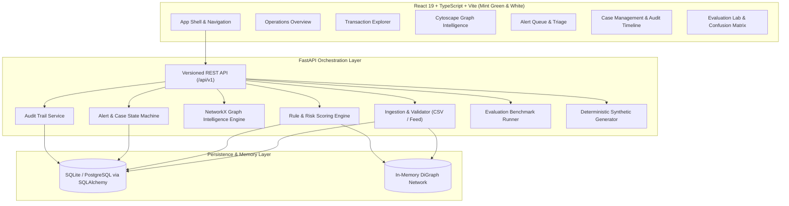
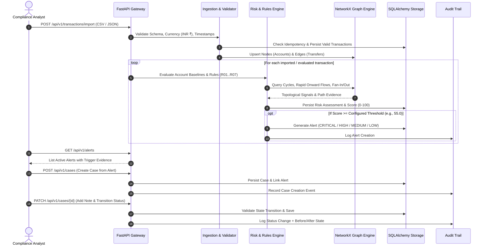
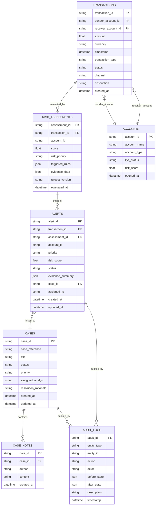

# TraceNet: System Architecture

---

## 1. System Overview & Component Responsibilities

TraceNet is an explainable decision-support platform designed for bank fraud and AML compliance teams. It orchestrates real-time transaction ingestion, rule-based risk scoring, directed network graph intelligence, alert triage, investigative case management, and immutable audit trails.



---

## 2. Data Flow & Transaction Lifecycle



---

## 3. Database Schema & Data Models

### 3.1 Relational Schema (SQLAlchemy ORM)



---

## 4. Graph Analytics Model

The transaction network is represented as an in-memory directed multigraph `G = (V, E)` using NetworkX:
- **Vertices (V)**: Accounts identified by pseudonymous IDs (e.g., `ACC-IND-7491`). Attributes: total sent, total received, net balance, degree, known risk score.
- **Edges (E)**: Transaction events `(u, v, key)`. Attributes: `transaction_id`, `amount` (INR `₹`), `timestamp`, `channel` (UPI, IMPS, NEFT, RTGS), `status`.
- **Topological Features Computed**:
  - **Ego-Network / k-hop Neighborhood**: Extract induced subgraphs up to depth $k \le 3$ with max $N \le 100$ nodes to avoid memory bloat.
  - **Elementary Cycle Detection**: Directed cycle searches ($3 \le \text{length} \le 5$) executed on time-bounded sliding windows to identify circular layering paths ($A \to B \to C \to A$).
  - **Fan-In / Fan-Out Ratio**:
    $$\text{Fan-In Ratio} = \frac{\text{In-Degree}}{\text{Out-Degree} + 1}$$
    Detecting smurfing / money mule aggregation hubs.
  - **Rapid Onward Flow**: Tracing sequential incoming $\to$ outgoing fund movements within a bounded $\Delta t$ (e.g. within 30 minutes, outgoing amount $\ge 85\%$ of incoming amount).

---

## 5. API Endpoint Contracts

All routes are versioned under `/api/v1`:

| Method | Endpoint | Description |
|---|---|---|
| `GET` | `/api/v1/health` | Service health status and database connectivity |
| `POST` | `/api/v1/transactions/import` | Batch import transactions via CSV or JSON payload |
| `GET` | `/api/v1/transactions` | Query transactions with search, sorting, channel filters, pagination |
| `GET` | `/api/v1/transactions/{id}` | Retrieve individual transaction details and associated assessment |
| `POST` | `/api/v1/risk/assess` | Trigger risk scoring on a specific transaction or batch |
| `GET` | `/api/v1/alerts` | Query active and historical alerts filtered by priority/status |
| `GET` | `/api/v1/alerts/{id}` | Detailed alert evidence, triggered rules, and linked case |
| `GET` | `/api/v1/graph/network/{account_id}` | Bounded k-hop neighborhood graph with nodes, edges, and cycles |
| `GET` | `/api/v1/graph/cycles` | Top detected circular laundering paths across the network |
| `GET` | `/api/v1/cases` | List compliance investigation cases |
| `POST` | `/api/v1/cases` | Create a new case and optionally attach alerts |
| `GET` | `/api/v1/cases/{id}` | Case detail with linked alerts, transactions, and notes |
| `PATCH` | `/api/v1/cases/{id}` | Update case status, assign analyst, or close with rationale |
| `POST` | `/api/v1/cases/{id}/notes` | Append investigative note to case |
| `GET` | `/api/v1/cases/{id}/audit` | Filtered audit log for specific case lifecycle |
| `GET` | `/api/v1/audit` | System-wide audit log trail |
| `POST` | `/api/v1/demo/generate` | Generate deterministic synthetic Indian banking dataset |
| `GET` | `/api/v1/evaluation/run` | Execute benchmark evaluation against ground-truth labels |
| `GET` | `/api/v1/stats/overview` | Executive KPI dashboard aggregates |

---

## 6. Error-Handling Strategy

1. **Standardized JSON Error Structure**:
   ```json
   {
     "error": {
       "code": "RESOURCE_NOT_FOUND",
       "message": "Transaction 'TX-9999' was not found in the ledger.",
       "details": null,
       "timestamp": "2026-10-13T05:30:00Z"
     }
   }
   ```
2. **HTTP Status Codes**:
   - `400 Bad Request`: Validation failure (malformed CSV, missing required fields).
   - `404 Not Found`: Non-existent entity.
   - `409 Conflict`: Invalid state transition or duplicate idempotency key.
   - `422 Unprocessable Entity`: Schema constraint violation (Pydantic validation).
   - `500 Internal Server Error`: Safe sanitized error messages (stack traces suppressed).

---

## 7. Audit Architecture

Every modifying action executes through the `AuditService`:
- Captures: `actor` (analyst ID or 'SYSTEM'), `action` (`TRANSACTION_IMPORT`, `RULE_EVALUATION`, `ALERT_GENERATED`, `CASE_CREATED`, `CASE_STATUS_CHANGED`, `NOTE_ADDED`), `entity_type`, `entity_id`, `before_state`, `after_state`, and timestamp.
- Prototype uses SQLite table `audit_logs` with indexed timestamps.
- Institutional scaling path: Forward audit events to an immutable WORM (Write Once Read Many) append-only event store (e.g., AWS S3 Object Lock, Kafka with tamper-evident hash chaining).

---

## 8. Scaling Path & Institutional Roadmap

1. **Storage Tier**: SQLite $\to$ PostgreSQL with read replicas; TimeScaleDB or ClickHouse for multi-billion transaction streaming ledgers.
2. **Graph Intelligence Tier**: NetworkX $\to$ Neo4j cluster or AWS Neptune for distributed sub-second multi-hop graph queries.
3. **Stream Ingestion**: FastAPI endpoint $\to$ Apache Kafka / Redpanda pipeline with Apache Flink for real-time sliding-window feature aggregations.
