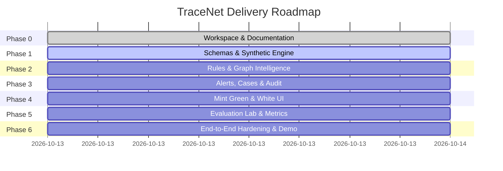

# TraceNet: Product & Engineering Roadmap

---

## Roadmap Overview & Milestones

TraceNet is engineered in structured phases to ensure a rock-solid, explainable, bank-grade demonstration platform with complete end-to-end traceability.

---

## 1. Feature Status Matrix

| ID | Milestone | Feature Description | Status | Dependency |
|---|---|---|---|---|
| **P0-1** | Foundation | SQLite DB schema, SQLAlchemy models, Pydantic validation | Complete | - |
| **P0-2** | Foundation | Deterministic synthetic Indian banking data generator | Complete | P0-1 |
| **P0-3** | Ingestion | CSV parser with column mapping, deduplication & idempotency | Complete | P0-1 |
| **P0-4** | Detection | 7 Explainable risk rules (R01 to R07) with test suites | Complete | P0-1, P0-2 |
| **P0-5** | Graph | NetworkX graph engine (cycles, ego-network, fan-in/out) | Complete | P0-1 |
| **P0-6** | Workflow | Persistent Alerts, Case management state machine, Notes | Complete | P0-1, P0-4 |
| **P0-7** | Compliance | Immutable structured audit log service | Complete | P0-1, P0-6 |
| **P0-8** | Security | Analyst login & credential authentication | Complete | P0-1 |
| **P0-9** | UI - Theme | Mint Green & White institutional dashboard theme | Complete | - |
| **P0-10**| UI - Screens | 6 core views (Overview, Txns, Graph Intel, Alerts, Cases, Lab) | Complete | P0-4, P0-5, P0-6 |
| **P0-11**| UI - Graph | Interactive Live Graph Intelligence with Indian ranges | Complete | P0-5, P0-9 |
| **P0-12**| Evaluation | Quantitative Evaluation Lab (Precision, Recall, F1, Confusion Matrix) | Complete | P0-2, P0-4 |
| **P1-1** | Stream Sim | Live streaming transaction simulation feed | Complete | P0-3, P0-4 |
| **P1-2** | Rule Tuning | Interactive rule parameter threshold tuner in UI | Scheduled | P0-4 |
| **P2-1** | Institutional | PostgreSQL / Neo4j enterprise deployment driver | Deferred | P0-1, P0-5 |
| **P2-2** | Regulatory | Automated STR / SAR filing package generator (FIU-IND format) | Deferred | P0-6 |

---

## 2. Definition of Done (DoD) by Milestone

### Phase 0: Workspace & Documentation (COMPLETE)
- [x] Workspace initialized with clean Git repository.
- [x] PRD.md, ARCHITECTURE.md, RULES.md, ROADMAP.md, DESIGN.md, CONTEXT.md drafted.
- [x] Python virtual environment created with all core dependencies installed.

### Phase 1: Foundations & Ingestion
- [ ] SQLAlchemy database models with indexes.
- [ ] Deterministic synthetic transaction generator (`generate_dataset.py`) with INR amounts, realistic Indian accounts (`ACC-IND-xxxx`), channels (UPI, IMPS, NEFT, RTGS).
- [ ] Ingestion service with duplicate detection and error handling.
- [ ] Automated unit tests for validation and ingestion passing.

### Phase 2: Explainable Detection & Graph Analytics
- [ ] 7 rules implemented in `risk_engine.py`.
- [ ] Graph analytics module in `graph_engine.py` (cycle finder, neighborhood extractor, degree distributions).
- [ ] Automated tests covering all rules and normal counterexamples passing.

### Phase 3: Case Lifecycle & Audit Trail
- [ ] Alert generation threshold pipeline.
- [ ] Case state machine: `NEW -> UNDER_INVESTIGATION -> ESCALATED / SAR_RECOMMENDED / CLOSED_RESOLVED / CLOSED_FALSE_POSITIVE`.
- [ ] Case notes and analyst assignment.
- [ ] Audit trail capturing all mutations.

### Phase 4: Frontend Development (Mint Green & White)
- [ ] Modern React + TypeScript + Vite architecture.
- [ ] Dedicated Analyst Login page with credential entry.
- [ ] Mint green (`#10B981` / `#059669` / `#E6F7F2`) and crisp white dashboard design system.
- [ ] Currency formatted as Indian Rupee (`₹`, Lakhs/Crores).
- [ ] Interactive Live Graph Intelligence with node selection, cycles highlighting, and depth filters.
- [ ] Operations Overview, Transaction Explorer, Alert Queue, Case Investigation, Evaluation Lab.

### Phase 5: Evaluation Lab & Baseline Comparison
- [ ] Benchmark execution against synthetic labelled test sets.
- [ ] Calculation of Precision, Recall, F1, FPR, Confusion Matrix.
- [ ] Latency benchmarking.

### Phase 6: Hardening, Verification & Polish
- [ ] All backend pytest suites pass 100%.
- [ ] Frontend builds cleanly with zero TypeScript errors.
- [ ] End-to-end user verification verified.
- [ ] Comprehensive README.md and documentation verified.
